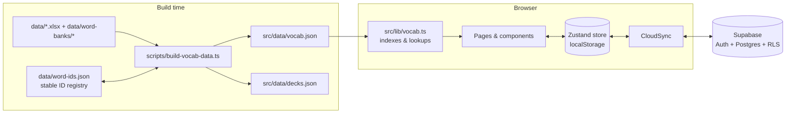

# Architecture

## Overview



- **The vocabulary is static.** All words ship in the JS bundle as JSON, so every page prerenders and search, quizzes, and lookups take no network round trips.
- **Progress is local-first.** Every action writes to Zustand, which persists to `localStorage` (`gre-lexicon-storage`), so the app works with no login.
- **Sync is optional.** When Supabase env vars exist and the user signs in, `CloudSync` merges local and remote progress, then pushes changes in the background (debounced 1.5s).

## Directory map

| Path | Purpose |
| --- | --- |
| `data/final imp GRE vocab.xlsx` | Primary word source (sheet `Vocabulary`) |
| `data/word-banks/` | Extra word banks (`.xlsx`/`.csv`, same columns). Files starting with `_` are ignored. |
| `data/word-ids.json` | Permanent word → ID registry. **Append-only.** |
| `scripts/build-vocab-data.ts` | Validates sources, dedupes, groups, assigns IDs and decks, and writes JSON |
| `src/data/` | Generated `vocab.json` and `decks.json` (committed) |
| `src/types/vocab.ts` | Shared domain types |
| `src/lib/vocab.ts` | Word indexes (`WORD_BY_ID`, `WORD_BY_TEXT`, `WORDS_BY_DECK`) and stem matching (`findWordRegex`) |
| `src/lib/pools.ts` | Word pools (deck / weak / starred / all / custom IDs) ↔ URL query |
| `src/lib/quiz-engine.ts` | Question building, smart distractors, cloze blanking, combo multipliers |
| `src/lib/speech.ts` | Web Speech API pronunciation |
| `src/lib/supabase.ts` | Optional client and progress/stats read/write |
| `src/store/useVocabStore.ts` | Persisted progress store and all progress mutations |
| `src/store/useUIStore.ts` | Ephemeral UI state (search, word detail modal, account dialog, sync status) |
| `src/components/ui/` | Primitives: Button, Card, Badge/Kbd, Progress, Dialog, Input/Select, Tabs, Tooltip |
| `src/components/` | App chrome: Navbar, CommandSearch (⌘K), WordDetailModal, AccountDialog, CloudSync, Providers |
| `src/components/{dashboard,learn,quiz,words}/` | Feature views |
| `src/app/` | Routes: `/`, `/learn`, `/quiz`, `/words` |
| `supabase/schema.sql` | Idempotent DB schema and RLS policies |

## Data pipeline

`npm run build:data` runs these steps:

1. Reads the primary sheet, then every file in `data/word-banks/` in alphabetical order. Rows missing any required column fail the build. Connotation is normalized to case.
2. Dedupes words case-insensitively. The first occurrence wins, and later ones produce a warning.
3. Groups words by `Group` (stored as `theme`) and sorts groups by size (descending, then alphabetically), so big synonym clusters land in the early decks.
4. Assigns IDs from `data/word-ids.json`. Known words keep their ID; new words get `max + 1`. Removed words keep their entry, so IDs are never reused.
5. Splits the words into decks of 50 (`deckId` is positional and **can change** when words are added; progress is unaffected).
6. Parses a leading `(pos.)` from `Definition` into `partOfSpeech` and capitalizes the definition.
7. Fills `synonyms` with every other word in the same `Group`.

## State model

```ts
progress: Record<wordId, {
  status: 'unseen' | 'learning' | 'reviewing' | 'mastered';
  isStarred; correctStreak; correctCount; incorrectCount;
  lastReviewedAt;   // last study/quiz interaction
  updatedAt;        // last change of any kind (sync conflict resolution)
}>
dailyStreak, lastStudyDate, totalQuizzesTaken, lastActiveDeck
```

Status rules:
- **Learn mode:** the grade sets the status directly. "Still Learning" re-queues the card at the end of the session.
- **Quiz mode:** a correct answer increments `correctStreak`; a streak of 2 or more means `mastered`, a streak of 1 means `reviewing`. A wrong answer sets `learning` and resets the streak.
- **Daily streak:** it increments the first time you study on a new calendar day. It shows as 0 if more than a day was missed.

## Sync protocol (`src/components/CloudSync.tsx`)

1. **On sign-in:** pull all `user_word_progress` rows and `user_stats`, merge them into local state (per word, the newer `updatedAt` wins), then upsert the merged state back.
2. **While signed in:** watch the store, collect changed word IDs, and batch-upsert them 1.5s after the last change. Changes are also flushed on `pagehide`.
3. **On sign-out:** `AccountDialog` pushes everything first, then signs out, and `CloudSync` clears local data. This stops one user's progress from merging into the next user's account on a shared device.

## Database

| Table | Key | Notes |
| --- | --- | --- |
| `user_word_progress` | `(user_id, word_id)` | One row per word the user has touched; `client_updated_at` drives merges |
| `user_stats` | `user_id` | Daily streak, quizzes taken, last active deck |

RLS is enabled on both tables. Every policy restricts access to `auth.uid() = user_id`, so the anon key is safe to expose.

## Rendering notes

- All routes are static (`○` in the build output). Search params are read on the client under `<Suspense>`.
- `cacheComponents` keeps recently visited pages alive with React `<Activity>`. Learn and quiz sessions are therefore preserved when you switch tabs; they reset when their `key` (the URL query) changes.
- The theme (light/dark) is applied before first paint by an inline script (`src/lib/theme-script.ts`) that reads `localStorage.theme`.

## Extending

| Want to… | Where |
| --- | --- |
| Add words or word banks | [ADDING_WORDS.md](ADDING_WORDS.md) |
| Deploy or configure auth | [DEPLOYMENT.md](DEPLOYMENT.md) |
| Add a quiz format | `src/lib/quiz-engine.ts` + `PromptHeader` in `QuizRunner.tsx` |
| Add a leaderboard or XP | New table + RLS in `schema.sql`, write from `CloudSync` or a server route, then read it in a new page |
