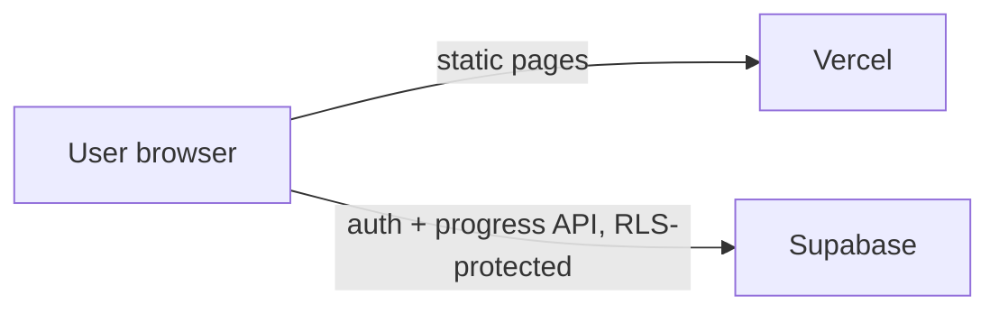

# Deployment: Vercel + Supabase

Vercel hosts the Next.js app. Supabase provides login (Google and email magic link) and the Postgres database that stores each user's progress: statuses, stars, streaks, and quiz counts.



## 1. Create the Supabase project

1. Go to https://supabase.com, choose **New project**, and pick a region close to your users. Under the security options:
   - **Enable Data API:** on (supabase-js needs it)
   - **Automatically expose new tables:** off (`schema.sql` grants access explicitly)
   - **Enable automatic RLS:** on
2. Open **SQL Editor → New query**, paste the full contents of [`supabase/schema.sql`](../supabase/schema.sql), and click **Run**. The script is idempotent, so you can re-run it after schema updates.
3. Open **Project Settings → API** and copy:
   - **Project URL** → `NEXT_PUBLIC_SUPABASE_URL`
   - **anon / publishable key** → `NEXT_PUBLIC_SUPABASE_ANON_KEY`

   The anon key is meant to be public. Row-Level Security makes sure each user can only read and write their own rows. **Never** put the `service_role` key in a `NEXT_PUBLIC_` variable.

## 2. Configure authentication

### URL configuration (Authentication → URL Configuration)

- **Site URL:** your production URL, e.g. `https://gre-lexicon.vercel.app`
- **Redirect URLs:** add each of these:
  - `http://localhost:3000/**`
  - `https://gre-lexicon.vercel.app/**` (your production domain)
  - `https://*-YOUR-VERCEL-TEAM.vercel.app/**` (preview deployments, optional)

### Email magic link

- **Authentication → Providers → Email:** enable it.
- Supabase's built-in email service is heavily rate-limited (only a few emails per hour) and meant for testing. For real users, set up custom SMTP under **Project Settings → Auth → SMTP** (e.g. Resend, Postmark, or SES).

### Google sign-in

1. In [Google Cloud Console](https://console.cloud.google.com/): **APIs & Services → OAuth consent screen**. Configure it as External and add your app name and support email.
2. Go to **Credentials → Create credentials → OAuth client ID → Web application**.
   - **Authorized JavaScript origins:** `https://gre-lexicon.vercel.app` and `http://localhost:3000`
   - **Authorized redirect URI:** `https://YOUR-PROJECT-REF.supabase.co/auth/v1/callback`
3. Copy the Client ID and Secret into **Supabase → Authentication → Providers → Google** and enable the provider.

## 3. Local check

```bash
cp .env.example .env.local   # fill in the two values
npm run dev
```

Open the person icon in the navbar → **Continue with Google** or **Email link**. After you sign in, the sync status there should read `synced`. You can confirm rows in **Supabase → Table Editor → user_word_progress**.

## 4. Deploy to Vercel

1. Push the repo to GitHub.
2. At https://vercel.com/new, import the repo. The framework is detected as Next.js with the default build settings.
3. Under **Settings → Environment Variables**, add `NEXT_PUBLIC_SUPABASE_URL` and `NEXT_PUBLIC_SUPABASE_ANON_KEY` for Production (and Preview if you want).
4. Deploy. `NEXT_PUBLIC_*` values are baked in at build time, so **redeploy after changing them**.
5. If you add a custom domain, add it to the Supabase Site URL and Redirect URLs, and to the Google authorized origins.

## What is tracked per user

| Data | Where |
| --- | --- |
| Mastery status per word (unseen / learning / reviewing / mastered) | `user_word_progress.status` |
| Starred words | `user_word_progress.is_starred` |
| Quiz accuracy per word | `correct_count`, `incorrect_count`, `correct_streak` |
| Last reviewed time | `last_reviewed_at` |
| Daily streak, quizzes taken, last deck | `user_stats` |

Signed-out users keep progress on their device only. When they sign in, that progress is merged into their account.

## Updating after deploy

- **Code or word changes:** push to `main` and Vercel redeploys.
- **Schema changes:** edit `supabase/schema.sql` (keep it idempotent) and re-run it in the SQL Editor *before* deploying code that depends on it.

## Troubleshooting

| Symptom | Fix |
| --- | --- |
| Account dialog says "local-first mode" in production | Env vars are missing in Vercel, or you didn't redeploy after adding them |
| Redirect after login goes to localhost or errors | Site URL and Redirect URLs in Supabase don't include the domain |
| Google: `redirect_uri_mismatch` | The Google OAuth client must list `https://<ref>.supabase.co/auth/v1/callback` |
| Magic link emails stop arriving | Built-in SMTP rate limit; configure custom SMTP |
| Sync status shows `error` | Check that `schema.sql` was run (including the latest `alter table` lines) and look at the browser console |
